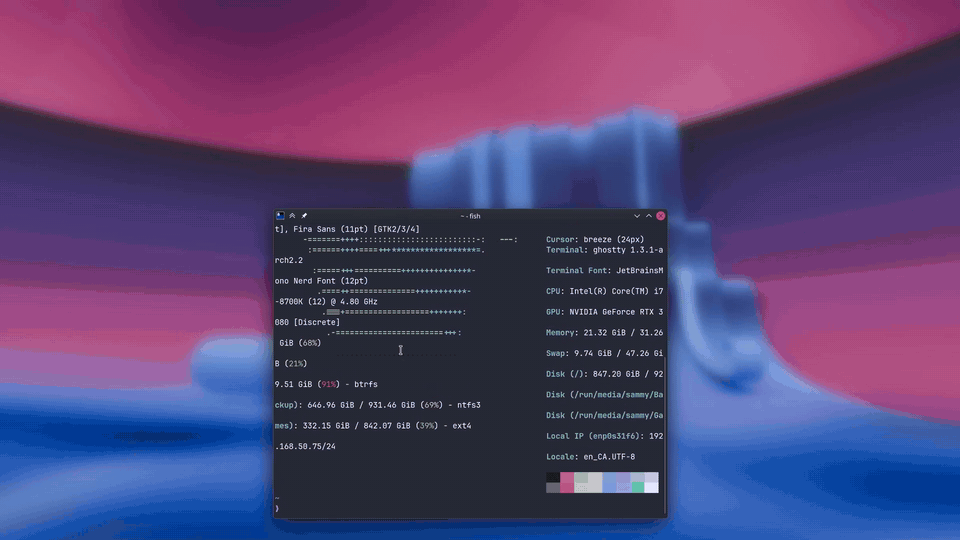

# FaceGate

<p align="center">
  
</p>

FaceGate is a Face ID-style interface for
[Howdy](https://github.com/boltgolt/howdy), the Linux face authentication
project that does the real work: it drives the IR webcam and performs the face
comparison. FaceGate doesn't replace any of that; it adds an explicit consent
screen before Howdy uses the camera for `sudo`, and shows the scan and its
result. Onboarding and settings live in that island too. FaceGate runs in the
tray, where **Open FaceGate** expands it into configuration. It uses a
true layer-shell surface, so the black island
is anchored to the monitor's physical top edge rather than placed as an
ordinary desktop window. The visual HUD runs in your normal desktop
session, while a tiny PAM adapter stays root-owned.

> **KDE Plasma on Wayland only.** FaceGate replaces Plasma's polkit agent and
> asks KWin which monitor you're on, so GNOME, Hyprland, Sway, X11 and other
> desktops aren't supported.

## What it changes

Only the Howdy rules for `sudo` and polkit are replaced:

```text
sudo / pkexec / KDE admin prompt → FaceGate consent HUD → existing Howdy compare.py → allow, or password fallback
```

- `/etc/pam.d/sudo` is edited in place (timestamped backup in `/etc/facegate/`).
  Besides the auth rule it adds an `optional` account rule, which only tells
  the island "Verified" after sudo accepted a password typed there.
- Polkit's rule ships in `/usr/lib/pam.d/polkit-1`, so the installer writes an
  overriding `/etc/pam.d/polkit-1` with the Howdy line gated. It survives package
  updates, and the uninstaller removes it.
- For graphical admin prompts (pkexec, Discover, System Settings, …) FaceGate
  is the session's **polkit authentication agent**, replacing KDE's
  "Authentication Required" dialog (the installer stops and masks
  `plasma-polkit-agent.service`; the uninstaller restores it). The island is the
  only prompt: approve to scan your face; after **Deny**, or no face
  match it turns into a password field (**Cancel** / **Allow**, three tries).
  If no usable face model exists—including while adding the first one—it skips
  the camera and asks for the typed sudo password immediately.
- `sudo` without an enrolled face asks for the password in the island too
  (**Cancel** / **Allow**). The typed password is handed to PAM as the
  authentication token, and `pam_unix` checks it as usual, so a wrong one reads
  "Incorrect password. Try again." on the next of sudo's tries. Cancel, a
  missing island, `sudo -S` and `-n` keep their usual prompt; an app's
  graphical askpass (`sudo -A`, as paru and Arch Update use) is replaced by the
  island, and Cancel falls back to it. With a
  face enrolled, **Deny** still leaves sudo at its terminal prompt.

SDDM is deliberately untouched. If FaceGate is closed, rejects the request,
times out, or face recognition fails, PAM continues to the normal password
prompt. The **Approve** button is not authentication; it solely permits the
camera scan to begin.

## HUD states

- **‹App› wants sudo** — names the app that ran sudo, the exact command, and
  the app hosting it; the camera stays off until you approve.
- **Looking for you** — a scanning arc sweeps the mark while Howdy runs.
- **Verified** — the arc closes into a green ring before sudo continues.
- **Not recognized** — a brief red shake, then the normal password prompt.

Press **Deny** to decline, or Escape to dismiss the island at any point.

The spacing and hierarchy are governed by the measured [layout contract](DESIGN.md),
including the grid, concentric radii, and spring-based motion choreography.

## Settings and faces

Choose **Open FaceGate** from its tray menu, open **FaceGate** from the app
menu, or run `facegate-settings`. Every route expands the top-edge island;
there is no separate settings window. The first time, it shows how FaceGate
works over three short pages (replay them with
`facegate-settings --welcome`, or **Replay Welcome** at the foot of the main
screen), then helps you add your face. After that the
main screen shows the installed version, a global FaceGate switch, and two
destinations:

- **Face Approval** lists the faces Howdy knows for your account. Its large
  header collapses into a compact bar as you scroll.
- **View Options** follows the pointer by default, or locks the island to one
  connected monitor. A disconnected locked monitor falls back to the pointer
  until it returns.

Turning FaceGate off takes it out of the way entirely: sudo and admin
requests use their usual password prompts, even if the island isn't running,
until it is turned on again. Saved faces and preferences are kept.

- **Add a Face** reshapes the same island into admin approval. Once approved,
  that same surface transitions directly into a live, face-following IR preview
  feathered into its rounded
  rectangle. A trace fills its rim clockwise as samples are captured, while the
  island says what it needs ("Move a little closer"), then closes green.
  Cancel or Escape stops the scan and saves nothing.
- **Rename** a face with its pencil button: edit the name in place, then press
  Return. It also asks for admin approval; Escape cancels.
- **Remove** a face with the trash button, then **Remove** again. It also asks
  for admin approval. Clicking anywhere else, or Escape, backs out.

Faces are Howdy's own models, so `sudo howdy list` shows them too. Each one
keeps five encodings taken a moment apart, rather than Howdy's single frame.
The visual language, spacing and motion rules are in [DESIGN.md](DESIGN.md).

## Install

Requirements: an Arch-based system running KDE Plasma on Wayland, and a
webcam (an infrared one works best).

```bash
git clone https://github.com/sguergachi/facegate.git
cd facegate
./setup.sh
```

Run it as yourself, not with `sudo`. Setup walks through:

1. Installing FaceGate's packages (GTK 4, `gtk4-layer-shell`, AppIndicator,
   PyGObject, pycairo, `v4l-utils`).
2. Installing [Howdy](https://github.com/boltgolt/howdy) and `pam-python` from
   the AUR with `paru` or `yay`, offering to install `paru` if neither exists.
   Building dlib can take 10 minutes or more.
3. Choosing the camera, preferring an infrared sensor when there is one.
4. Running `install.sh`, which puts FaceGate in front of `sudo` and polkit
   prompts. Your password still works as a fallback.
5. Opening FaceGate's onboarding, which explains how it works and adds your
   face.

If Howdy is already set up, setup skips what's done. `sudo ./install.sh` on its
own only does step 4.

The supplied user service preloads the installed layer-shell library so the GTK
introspection binding receives the layer role before GTK connects to Wayland.

The installer creates a timestamped backup in `/etc/facegate/` before it edits
the PAM file. To revert:

```bash
sudo ./uninstall.sh
```

## Test mode

Run the HUD from this checkout without PAM, Howdy, or the camera. It loops the
real flow (approve → simulated scan → alternating success/failure; decline via
Deny or Escape) and does not touch the
installed service:

```bash
scripts/demo.sh
```

To loop the Add Face scan with your real camera instead (it counts samples but
never loads Howdy's models or saves a face):

```bash
scripts/demo.sh enroll
```

## Development checks

```bash
PYTHONPATH=. python3 -m unittest discover -s tests -v
python3 -m py_compile facegate/*.py
python2 -m py_compile pam/facegate-pam.py
shellcheck install.sh uninstall.sh scripts/demo.sh
```

## Security model

The Unix socket is mode `0600` in `/run/user/$UID`, and the HUD lives entirely
in the user's desktop session so it can render under Wayland. Its response only
starts Howdy. A successful Howdy comparison remains the sole successful PAM
result; the HUD cannot grant sudo on its own. A password typed in the island
for sudo goes back over that socket to the root PAM module, which only hands it
to `pam_unix`; it is never logged, stored, or checked by FaceGate. FaceGate
never stores camera frames, passwords, or sudo credentials.

A successful face match also clears the account's consecutive `pam_faillock`
password failures, just as a successful password does. Earlier dismissed
prompts therefore cannot leave the typed fallback locked after the last face
is removed.

FaceGate's in-island configuration reads and changes faces through two small root helpers,
started with `pkexec`, because Howdy's models are root-only:

- `facegate-faces-list` (polkit action `org.facegate.list-faces`) only returns
  labels and dates, so an active local session needs no prompt.
- `facegate-faces` (polkit action `org.facegate.manage-faces`) adds or removes
  a face. It asks for admin authentication every time and never keeps it.

Both only ever touch the models of the user who ran them, and each run does
one thing and exits. Face templates are written to Howdy's store
(`/usr/lib/security/howdy/models`) and never leave the machine. Preview frames
go from the helper's pipe straight to the island in the same process and are
not saved. The
installed package is root-owned so no user process can change the helpers'
code.

## Credits

Face recognition, IR camera handling, and the PAM integration FaceGate builds on
come from [Howdy](https://github.com/boltgolt/howdy) by boltgolt and its
contributors. FaceGate is an independent UI layer and is not affiliated with the
Howdy project; please report recognition or camera issues to Howdy and UI issues
here.
